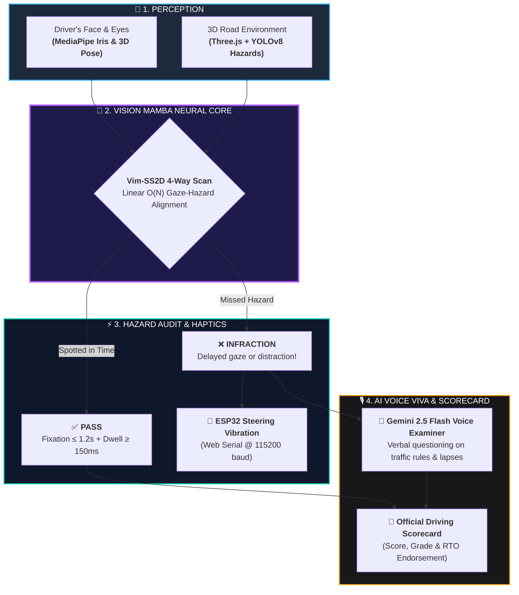

# GazeDrive AI: Next-Gen Driver Attention & Hazard Perception Platform

> **Autonomous In-Cabin Monitoring · Vision Mamba (Vim-SS2D) Spatial SSM · ESP32 Physical Haptics · Gemini 2.5 Flash Voice Viva Examiner**

[](https://vitejs.dev/)
[](https://threejs.org/)
[](https://developers.google.com/mediapipe)
[](https://fastapi.tiangolo.com/)
[](https://ai.google.dev/)
[](https://developer.mozilla.org/en-US/docs/Web/API/Web_Serial_API)

---

## 🌟 Overview

**GazeDrive AI** is an end-to-end, closed-loop driver attention assessment and intelligent hazard perception platform. It replaces subjective human examiner bias in driving tests with sub-millimeter computer vision, a linear-time **Vision Mamba (Vim-SS2D)** State-Space Model, physical **ESP32 microcontroller haptic feedback**, and an autonomous **Gemini 2.5 Flash AI Voice Viva Examiner**.

### 💡 High-Level System Flow



---

## ✨ Key Features & Technical Highlights

### 1. In-Cabin Eye Tracking & Head Pose (MediaPipe Iris)
* **478 3D Landmarks**: Tracks eye coordinates and isolates landmarks 468–477 to extract sub-millimeter normalized iris gaze displacement vectors $(\Delta x, \Delta y)$.
* **3D Head Pose Orientation**: Solves Perspective-n-Point (PnP) for Head Pitch, Yaw, and Roll to detect distraction zones (Speedometer, Left/Right Mirrors, Mobile Phone).
* **Fatigue & Drowsiness**: Computes real-time **Eye Aspect Ratio (EAR)** and **PERCLOS** ($\ge 15\%$ triggers drowsiness alerts).
* **9-Point Screen Calibration**: Interactive 9-point screen calibration matrix ensuring spatial RMS error $\le 45\text{ px}$.

### 2. Vision Mamba (Vim-SS2D) State-Space Engine
* **Linear Time Complexity $O(N)$**: Replaces quadratic $O(N^2)$ Vision Transformers with continuous-time State-Space Models discretized via Zero-Order Hold (ZOH).
* **4-Way 2D Selective Scan (SS2D)**: Scans 192 image patches in 4 directions (Horizontal $\to$, $\leftarrow$ and Vertical $\downarrow$, $\uparrow$) to preserve 2D spatial context.
* **Temporal Gaze Cross-Fusion**: Computes instantaneous cross-attention alignment between the driver's foveal gaze vector and spatial hazard locations in sub-7ms latency.

### 3. Realistic 3D Vehicle Dynamics & Physics (Three.js)
* **Proportionally Accurate Sports Sedan**: Redesigned car geometry (~1.46m wide, 3.55m long) fitting realistically in a 4.4m road lane (occupies only ~33% of the lane).
* **Aerodynamic Styling**: Sloped hood, raked windshield, gloss-black front splitter, rear lip spoiler, diffuser, chrome dual exhausts, and full-width continuous neon red LED lightbar.
* **Manual Transmission & Physics**: Functional 5-speed transmission with Reverse and Neutral (`R`, `N`, `1`, `2`, `3`, `4`, `5`), realistic engine RPM simulation, and low-speed high-gear engine stalling.
* **Flexible Dual-Camera Views**: First-person Cockpit Driver view (`DRIVER`) and third-person Chase view (`CHASE`) with one-click HUD toggle and `[V]` / `[C]` hotkeys.

### 4. Hazard Perception & Regulatory Evaluation Engine
* **Offline YOLOv8 Scenarios**: Real-time evaluation against pedestrians, emergency braking vehicles, and traffic light compliance (`scenarios.json`).
* **First-Fixation Latency**: Evaluates whether the driver acquires newly entering hazards within international licensing standards ($T_{\text{fixation}} \le \mathbf{1200\text{ ms}}$).
* **Secondary Dwell Verification**: Verifies foveal confirmation ($T_{\text{dwell}} \ge \mathbf{150\text{ ms}}$).
* **Alert-to-Freeze Reaction Window**: Monitors physical braking or swerving reaction to classify trial outcomes as `SUCCESS` or `COLLISION`.

### 5. Physical Microcontroller Haptic Feedback (ESP32)
* **Direct Web Serial API**: Browser connects directly to physical ESP32 microcontrollers over USB COM port at **115200 baud** without extra bridge software.
* **Tactile Alert Pulses**: Dispatches structured packets (`VIB:ALERT:300:75`) to drive ERM/LRA vibration actuators on the steering wheel or seat upon safety infractions.

### 6. Gemini 2.5 Flash AI Voice Viva Examiner
* **Autonomous Oral Inquiry**: When candidates fail $\ge 2$ hazards or complete their driving test, Gemini Flash is summoned.
* **Context-Aware Question Generation**: Injects the candidate's exact telemetric metrics (latency in ms, dwell time, vehicle speed, rule violations) into the oral inquiry.
* **Bidirectional Speech (Web Speech API)**: Speaks questions aloud via `SpeechSynthesis` and transcribes candidate spoken answers in real time via `SpeechRecognition`.
* **Automated Scoring Rubric**: Grades answers (Grade A/B/C/Fail, Score out of 100) based on traffic rule knowledge, hazard awareness, and defensive driving procedure.

---

## 🏗️ Architecture & Component Hierarchy

```
main_project/
├── index.html              # HTML5 entry layout, dashboard cards, canvas mount
├── style.css               # Glassmorphic dark UI, animated gauges, responsive layout
├── main.js                 # Three.js animation loop, camera controllers, lighting
├── car.js                  # 3D car mesh, 5-speed transmission, RPM, steering wheel
├── road.js                 # Infinite recycled highway, asphalt shaders, lane markings
├── trafficLight.js         # Interactive 3-phase traffic signals & stop line sensors
├── trafficSigns.js         # Regulatory speed limit signs (30/50 km/h, School Zone)
├── hazards.js              # Three.js 3D dynamic obstacle rendering & animation
├── scenarioEngine.js       # 60 Hz hazard fixation & alert-to-freeze reaction engine
├── visionMamba.js          # Vim-SS2D 2D selective scan & temporal cross-attention
├── aiDetection.js          # MediaPipe Iris tracking, 3D head pose, EAR, PERCLOS
├── gazeCalibration.js      # 9-Point interactive gaze screen calibration
├── esp32Haptics.js         # Web Serial API driver for USB ESP32 haptic vibration
├── geminiViva.js           # Gemini 2.5 Flash Voice Viva Examiner & speech synthesis
├── ruleEngine.js           # Stop line compliance, red lights, speed limit adherence
├── telemetry.js            # Per-frame driving dataset recorder, CSV/JSON exporter
├── controls.js             # Keyboard event handler & virtual onscreen touch pedals
├── hud.js                  # Dashboard UI controller, arc gauges, modals & overlays
├── config.js               # Centralized tuning parameters, physics constants, colors
├── server.py               # FastAPI Python backend (scenarios, results, Gemini proxy)
├── package.json            # Vite build configuration & npm dependencies
└── public/
    └── scenarios.json      # Offline YOLOv8 hazard bounding box scenario definitions
```

---

## 🎮 Controls & Keybindings

| Key | Action | Description |
| :--- | :--- | :--- |
| **W** / **Up Arrow** | Throttle | Accelerates vehicle smoothly up to current gear speed limit |
| **S** / **Down Arrow** | Brake | Applies primary disc brakes with glowing rear brake lights |
| **A** / **Left Arrow** | Steer Left | Turns front alloy wheels and rotates cockpit steering wheel |
| **D** / **Right Arrow** | Steer Right | Scales steering proportionally to road speed |
| **Spacebar** | Handbrake | Applies heavy rear braking force |
| **V** or **C** | Toggle Camera | Switches between First-Person Cockpit View and Third-Person Chase View |
| **B** | Seatbelt Toggle | Buckles or releases driver seatbelt (pre-drive test requirement) |
| **E** / **]** | Upshift Gear | Shifts transmission up (`1` $\to$ `2` $\to$ `3` $\to$ `4` $\to$ `5`) |
| **Q** / **[** | Downshift Gear | Shifts transmission down (`5` $\to$ `4` $\to$ `3` $\to$ `2` $\to$ `1` $\to$ `N` $\to$ `R`) |
| **M** | Voice Mic | Toggles candidate microphone for Gemini Voice Viva answer |
| **X** | Export Telemetry | Downloads session telemetry as `.csv` and `.json` audit files |
| **G** | Toggle Debug HUD | Displays real-time FPS, coordinate vectors, and hazard boxes |
| **T** | Traffic Rules Debug | Displays traffic light state, stop line distance, and rule violations |
| **R** | Reset Car | Resets vehicle to start line, clears engine stall, and restarts scenario |

---

## 🚀 Quickstart & Setup Guide

### 1. Prerequisites
* **Node.js** (v18.0 or higher)
* **Python** (v3.10 or higher)
* A modern browser with WebGL & Web Serial support (Google Chrome or Microsoft Edge recommended)
* A working RGB webcam

### 2. Frontend Installation & Startup
```bash
# Clone the repository
git clone https://github.com/your-username/gazedrive-ai.git
cd main_project

# Install node dependencies
npm install

# Start Vite development server
npm run dev
```
Open **`http://localhost:5173`** in your browser.

### 3. Backend Setup (FastAPI & Gemini Voice Viva)
In a separate terminal window:
```bash
# Install Python dependencies
pip install fastapi uvicorn pydantic requests

# (Optional) Export your Gemini API Key for dynamic cloud LLM generation:
export GEMINI_API_KEY="your-gemini-api-key-here"     # Linux/macOS
$env:GEMINI_API_KEY="your-gemini-api-key-here"      # Windows PowerShell

# Start FastAPI server
python server.py
```
The backend will launch at **`http://localhost:8000`** with interactive Swagger documentation available at `http://localhost:8000/docs`.

### 4. ESP32 Microcontroller Haptic Setup (Optional Physical Hardware)
1. Flash your ESP32 with firmware listening on USB Serial at `115200 baud`.
2. Connect the ESP32 to your PC via USB.
3. In the GazeDrive dashboard, scroll to the **ESP32 Haptic Actuator** panel and click **"Connect ESP32 (Web Serial)"**.
4. Select your ESP32 COM port in the browser popup. Click **"Test Pulse"** to verify tactile feedback!

---

## 📐 Mathematical Formulations

### 1. Vision Mamba (Vim-SS2D) State-Space Recurrence
Unlike Transformers that suffer from $\mathcal{O}(N^2)$ quadratic complexity, Vision Mamba processes visual tokens in **linear time $\mathcal{O}(N)$**:
$$h_t = \mathbf{\bar{A}} h_{t-1} + \mathbf{\bar{B}} x_t, \quad y_t = \mathbf{C}_t h_t + \mathbf{D} x_t$$
where parameters are discretized using input-dependent step size $\Delta$:
$$\mathbf{\bar{A}} = \exp(\Delta \mathbf{A}), \quad \mathbf{\bar{B}} \approx \Delta \mathbf{B}$$

### 2. Driver Drowsiness via Eye Aspect Ratio (EAR) & PERCLOS
$$\text{EAR} = \frac{\|p_2 - p_6\| + \|p_3 - p_5\|}{2 \|p_1 - p_4\|}$$
$$\text{PERCLOS} = \frac{\sum t_{\text{closed}}}{T_{\text{window}}} \times 100\% \quad (>15\% \implies \text{Drowsy Fatigue})$$

### 3. Exponential Moving Average (EMA) Gaze Smoothing
$$G_t = 0.70 \cdot G_{t-1} + 0.30 \cdot g_t$$

### 4. Hazard Fixation Latency & Dwell Thresholds
$$T_{\text{fixation}} = t_{\text{box\_entry}} - t_{\text{onset}} \le 1200\text{ ms} \quad (\text{PASS})$$
$$T_{\text{dwell}} = \sum \Delta t_{\text{inside}} \ge 150\text{ ms} \quad (\text{PASS})$$

---

## 📄 License & Academic Attribution
Developed as an advanced agentic Autonomous Driver Assessment & In-Cabin Perception platform. Feel free to use and extend this codebase for academic research, human-computer interaction (HCI) experiments, and driver safety audits.
