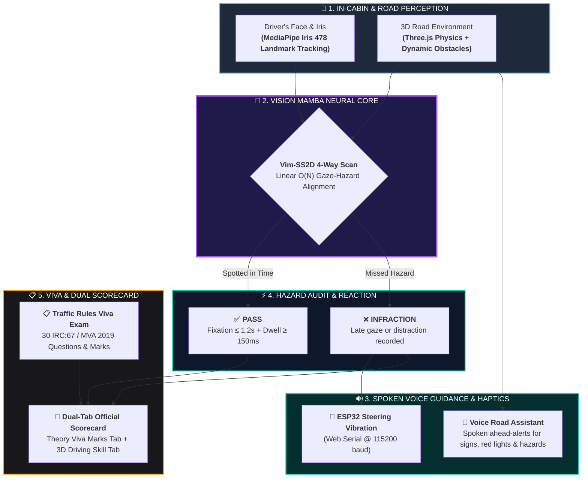

# GazeDrive AI: Next-Gen Driver Attention, Hazard Perception & Viva Platform

> **Autonomous In-Cabin Monitoring · Vision Mamba (Vim-SS2D) Spatial SSM · ESP32 Physical Haptics · Spoken Voice Navigation · Indian Traffic Rules Viva Examination · Dual-Tab Scorecard**

[](https://vitejs.dev/)
[](https://threejs.org/)
[](https://developers.google.com/mediapipe)
[](https://fastapi.tiangolo.com/)
[](https://developer.mozilla.org/en-US/docs/Web/API/Web_Speech_API)
[](https://developer.mozilla.org/en-US/docs/Web/API/Web_Serial_API)

---

## 🌟 Overview

**GazeDrive AI** is a comprehensive, end-to-end driver assessment, intelligent hazard perception, and regulatory compliance platform. It bridges realistic 3D simulation with real-time biometric driver monitoring:
1. **Perception**: Sub-millimeter iris eye tracking and 3D head pose orientation via MediaPipe.
2. **Deep Attention Core**: Linear-time **Vision Mamba (Vim-SS2D)** State-Space Model for cross-state-space gaze-hazard alignment.
3. **Voice Navigation Assistant**: Real-time Google Maps-style spoken alerts when approaching road signs, speed zones, and hazards.
4. **Physical Haptics**: Direct USB Web Serial connection to ESP32 microcontrollers for steering wheel vibration feedback.
5. **Traffic Rules Viva Examination**: 30-question interactive examination on Indian Roads Congress (IRC:67) signs and Motor Vehicles Act (MVA 2019) laws.
6. **Dual-Tab Official Scorecard**: Transparent evaluation separating candidate **Theory Viva Marks & Questions** from **3D Practical Driving Telemetry**.

---

### 💡 High-Level System Flow



---

## ✨ Key Features & Technical Highlights

### 1. In-Cabin Eye Tracking & Intelligent Auto-Resume (MediaPipe Iris)
* **478 3D Landmarks**: Isolates landmarks 468–477 to extract sub-millimeter normalized iris gaze displacement vectors $(\Delta x, \Delta y)$ with exponential moving average (EMA) smoothing.
* **3D Head Pose Orientation**: Solves Perspective-n-Point (PnP) for Head Pitch, Yaw, and Roll to detect distraction zones (Speedometer, Left/Right Mirrors, Mobile Phone).
* **Fatigue & Drowsiness**: Real-time **Eye Aspect Ratio (EAR)** and **PERCLOS** ($\ge 15\%$ triggers drowsiness alert).
* **Intelligent Auto-Resume & Manual Override**: Simulation automatically pauses when eyes are hidden/closed and **resumes automatically** as soon as the driver faces the camera with open eyes. Includes an on-screen **"Open Eyes & Resume"** button and hotkey `[C]`.
* **Clean Screen (No Obstacle Bounding Boxes)**: On-screen obstacle boxes are hidden by default for realistic driving immersion, while 100% of gaze tracking, foveal intersection, and latency checks execute uninterrupted in the background. Toggleable via `📦 Boxes: Off/On`.

### 2. Google Maps-Style Spoken Voice Road Assistant (`voiceNavigator.js`)
* **Real-Time Spoken Navigation Alerts**: Uses `window.speechSynthesis` with natural human voice pitch and rate to announce upcoming road conditions.
* **Proactive Hazard & Regulatory Announcements**:
  * *"School zone ahead. Reduce speed to 30 km/h."*
  * *"Red signal ahead. Stop behind the line."*
  * *"Signal turned green. You may proceed."*
  * *"Caution: Hazard detected ahead on the roadway."*
* **HUD Toggle & Hotkey**: Dedicated `🔊 Voice: On/Muted` button in the Road View header and `[M]` keyboard shortcut.

### 3. Traffic Rules Viva Examination (`indianTrafficRules.js`)
* **30-Question Official Regulatory Knowledge Base**: Compliant with Ministry of Road Transport and Highways (MoRTH), Indian Roads Congress (IRC:67-2012), and Motor Vehicles Act (MVA 2019).
* **4 Specialized Categories**:
  * 🛑 **Mandatory / Regulatory Signs**: STOP (octagonal), Give Way (inverted triangle), No Entry, Speed Limits (50 km/h), Compulsory Turn, No Horn.
  * ⚠️ **Cautionary / Warning Signs**: School Zone, Pedestrian Crossing, Speed Breaker, Narrow Bridge, Roundabout.
  * 🚗 **Rules of the Road**: Left-hand traffic driving, right-of-way at roundabouts, overtaking from the right, yielding to emergency vehicles.
  * ⚖️ **Penalties & Laws**: Section 184 (Dangerous Driving), Section 185 (Drunk Driving & $30\text{ mg}/100\text{ ml}$ BAC limit), mandatory seatbelts & helmets.
* **Instant Verification & Legal Citations**: Multiple-choice options with immediate color-coded feedback (green for correct, red for incorrect), verified correct rule answers, and MoRTH/IRC legal citations.
* **Modes & Controls**: Toggle between **Flashcard Mode** (study & flip) and **Quiz Mode** (scored evaluation), category filtering, and shuffle.

### 4. Dual-Tab Official Driving Test Scorecard
* **Tab 1: 📋 Traffic Rules Viva (Questions & Marks)**:
  * **Candidate Exam Marks**: Displays exact marks scored based on attempted questions (e.g. `5 / 5 MARKS (100% ACCURACY)`).
  * **Parivahan RTO Pass/Fail Benchmark**: Evaluated against the official $75\%$ passing threshold (`PASSED / TRAFFIC RULES VIVA QUALIFIED` vs `FAILED / VIVA RETEST REQUIRED`).
  * **Itemized Question Review**: Displays every question attempted with candidate choice, verified correct rule answer, IRC citation, and `+1 Mark · CORRECT ✓` or `0 Marks · INCORRECT ✗` pill.
  * **Retake Viva Action**: One-click `🔄 Retake Viva Exam` resets quiz state and reopens the examination.
* **Tab 2: 🚗 3D Driving Skill & Reaction Telemetry**:
  * Evaluates First-Fixation Latency ($\le 1200\text{ ms}$), Secondary Gaze Dwell ($\ge 150\text{ ms}$), Alert-to-Freeze defensive input, Traffic Signal & Stop Line obedience, Zone Speed Compliance, Road Sign Recognition, and Gaze Calibration RMS Error.
* **Seamless Switching**: Tab buttons in the modal header allow instant 1-click toggling between Theory Viva Marks and 3D Practical Driving Telemetry.

### 5. Vision Mamba (Vim-SS2D) State-Space Engine
* **Linear Time Complexity $\mathcal{O}(N)$**: Replaces quadratic $\mathcal{O}(N^2)$ Vision Transformers with continuous-time State-Space Models discretized via Zero-Order Hold (ZOH).
* **4-Way 2D Selective Scan (SS2D)**: Scans image patches in 4 orthogonal directions (Horizontal $\to$, $\leftarrow$ and Vertical $\downarrow$, $\uparrow$) to preserve 2D spatial context.
* **Temporal Cross-Attention**: Computes instantaneous cross-attention between driver gaze vectors and spatial hazard locations in sub-7ms latency.

### 6. Realistic 3D Vehicle Dynamics & Physics (Three.js)
* **Proportionally Accurate Sports Sedan**: Redesigned car mesh (~1.46m wide, 3.55m long) fitting realistically in a 4.4m road lane (occupies ~33% of lane width).
* **Aerodynamic Styling**: Sloped hood, raked windshield, gloss-black front splitter, rear lip spoiler, diffuser, chrome dual exhausts, and full-width continuous neon red LED lightbar.
* **Manual Transmission & Physics**: Functional 5-speed transmission with Reverse and Neutral (`R`, `N`, `1`, `2`, `3`, `4`, `5`), realistic engine RPM simulation, and low-speed high-gear engine stalling.
* **Dual-Camera Views**: First-person Cockpit Driver view (`DRIVER`) and third-person Chase view (`CHASE`) with one-click HUD toggle and `[V]` / `[C]` hotkeys.

### 7. Physical Microcontroller Haptic Feedback (ESP32)
* **Direct Web Serial API**: Browser connects directly to physical ESP32 microcontrollers over USB COM port at **115200 baud** without extra bridge software.
* **Tactile Alert Pulses**: Dispatches structured packets (`VIB:ALERT:300:75`) to drive ERM/LRA vibration actuators on the steering wheel upon safety infractions.

---

## 🏗️ Architecture & Component Hierarchy

```
main_project/
├── index.html              # HTML5 entry layout, dashboard cards, canvas mount
├── style.css               # Glassmorphic dark UI, animated gauges, tabs, scorecard styling
├── main.js                 # Three.js animation loop, camera controllers, lighting
├── car.js                  # 3D car mesh, 5-speed transmission, RPM, steering wheel
├── road.js                 # Infinite recycled highway, asphalt shaders, lane markings
├── trafficLight.js         # Interactive 3-phase traffic signals & stop line sensors
├── trafficSigns.js         # Regulatory speed limit signs (30/50 km/h, School Zone)
├── voiceNavigator.js       # Google Maps-style spoken road navigation alerts (Web Speech API)
├── indianTrafficRules.js   # 30-question Traffic Rules Viva knowledge base (IRC:67 / MVA 2019)
├── hazards.js              # Three.js 3D dynamic obstacle rendering & animation
├── scenarioEngine.js       # 60 Hz hazard fixation & alert-to-freeze reaction engine
├── visionMamba.js          # Vim-SS2D 2D selective scan & temporal cross-attention
├── aiDetection.js          # MediaPipe Iris tracking, 3D head pose, EAR, PERCLOS, auto-resume
├── gazeCalibration.js      # 9-Point interactive gaze screen calibration
├── esp32Haptics.js         # Web Serial API driver for USB ESP32 haptic vibration
├── ruleEngine.js           # Stop line compliance, red lights, speed limit adherence
├── telemetry.js            # Per-frame driving dataset recorder, CSV/JSON exporter
├── controls.js             # Keyboard event handler & virtual onscreen touch pedals
├── hud.js                  # Dashboard UI controller, Viva modal, dual-tab scorecard
├── config.js               # Centralized parameters, physics constants, overlay flags
├── server.py               # FastAPI Python backend (scenarios, results, Gemini proxy)
├── package.json            # Vite build configuration & npm dependencies
└── public/
    └── scenarios.json      # Offline YOLOv8 hazard bounding box scenario definitions
```

---

## 🎮 Controls & Keybindings

| Key | Action | Description |
| :--- | :--- | :--- |
| **W** / **Up Arrow** | Throttle | Accelerates vehicle smoothly up to current gear speed limit |
| **S** / **Down Arrow** | Brake | Applies primary disc brakes with glowing rear brake lights |
| **A** / **Left Arrow** | Steer Left | Turns front alloy wheels and rotates cockpit steering wheel |
| **D** / **Right Arrow** | Steer Right | Scales steering proportionally to road speed |
| **Spacebar** | Handbrake | Applies heavy rear braking force |
| **V** or **C** | Toggle Camera / Resume | Switches Cockpit / Chase view; resumes simulation if eyes paused |
| **B** | Seatbelt Toggle | Buckles or releases driver seatbelt (pre-drive test requirement) |
| **E** / **]** | Upshift Gear | Shifts transmission up (`1` $\to$ `2` $\to$ `3` $\to$ `4` $\to$ `5`) |
| **Q** / **[** | Downshift Gear | Shifts transmission down (`5` $\to$ `4` $\to$ `3` $\to$ `2` $\to$ `1` $\to$ `N` $\to$ `R`) |
| **M** | Voice Road Alerts | Toggles spoken navigation assistant (`🔊 Voice: On` / `🔇 Muted`) |
| **X** | Export Telemetry | Downloads session telemetry as `.csv` and `.json` audit files |
| **G** | Toggle Debug HUD | Displays real-time FPS, coordinate vectors, and hazard boxes |
| **T** | Traffic Rules Debug | Displays traffic light state, stop line distance, and rule violations |
| **R** | Reset Car | Resets vehicle to start line, clears engine stall, and restarts scenario |

### On-Screen Header & Footer Buttons
* **`🔊 Voice: On/Muted`**: One-click spoken navigation audio toggle in the Road View header.
* **`📦 Boxes: Off/On`**: Toggles visible bounding box wireframes on 3D road obstacles.
* **`🎥 View: Cockpit [V]`**: Toggles first-person cockpit driver camera and third-person chase camera.
* **`📋 Traffic Rules Viva`**: Opens the 30-question interactive Traffic Rules Viva Examination modal.
* **`⏹ End Test`**: Concludes the trial and displays the Official Driving Skill & Viva Report.

---

## 🚀 Quickstart & Setup Guide

### 1. Prerequisites
* **Node.js** (v18.0 or higher)
* **Python** (v3.10 or higher)
* A modern browser with WebGL & Web Serial support (Google Chrome or Microsoft Edge recommended)
* A working RGB webcam

### 2. Frontend Installation & Startup
```bash
# Clone the repository
git clone https://github.com/your-username/gazedrive-ai.git
cd main_project

# Install node dependencies
npm install

# Start Vite development server
npm run dev
```
Open **`http://localhost:5173`** (or port specified in terminal) in your browser.

### 3. Backend Setup (FastAPI Python Service)
In a separate terminal window:
```bash
# Install Python dependencies
pip install fastapi uvicorn pydantic requests

# Start FastAPI server
python server.py
```
The backend will launch at **`http://localhost:8000`** with interactive Swagger documentation available at `http://localhost:8000/docs`.

### 4. ESP32 Microcontroller Haptic Setup (Optional Physical Hardware)
1. Flash your ESP32 with firmware listening on USB Serial at `115200 baud`.
2. Connect the ESP32 to your PC via USB.
3. In the GazeDrive dashboard, scroll to the **ESP32 Haptic Actuator** panel and click **"Connect ESP32 (Web Serial)"**.
4. Select your ESP32 COM port in the browser popup. Click **"Test Pulse"** to verify tactile feedback!

---

## 📐 Mathematical Formulations

### 1. Vision Mamba (Vim-SS2D) State-Space Recurrence
Unlike Transformers that suffer from $\mathcal{O}(N^2)$ quadratic complexity, Vision Mamba processes visual tokens in **linear time $\mathcal{O}(N)$**:
$$h_t = \mathbf{\bar{A}} h_{t-1} + \mathbf{\bar{B}} x_t, \quad y_t = \mathbf{C}_t h_t + \mathbf{D} x_t$$
where parameters are discretized using input-dependent step size $\Delta$:
$$\mathbf{\bar{A}} = \exp(\Delta \mathbf{A}), \quad \mathbf{\bar{B}} \approx \Delta \mathbf{B}$$

### 2. Driver Drowsiness via Eye Aspect Ratio (EAR) & PERCLOS
$$\text{EAR} = \frac{\|p_2 - p_6\| + \|p_3 - p_5\|}{2 \|p_1 - p_4\|}$$
$$\text{PERCLOS} = \frac{\sum t_{\text{closed}}}{T_{\text{window}}} \times 100\% \quad (>15\% \implies \text{Drowsy Fatigue})$$

### 3. Exponential Moving Average (EMA) Gaze Smoothing
$$G_t = 0.70 \cdot G_{t-1} + 0.30 \cdot g_t$$

### 4. Hazard Fixation Latency & Dwell Thresholds
$$T_{\text{fixation}} = t_{\text{box\_entry}} - t_{\text{onset}} \le 1200\text{ ms} \quad (\text{PASS})$$
$$T_{\text{dwell}} = \sum \Delta t_{\text{inside}} \ge 150\text{ ms} \quad (\text{PASS})$$

### 5. Viva Examination Accuracy Score
$$\text{Score}_{\text{Viva}} = \left( \frac{N_{\text{correct}}}{N_{\text{attempted}}} \right) \times 100\% \quad (\ge 75\% \implies \text{RTO QUALIFIED})$$

---

## 📄 License & Attribution
Developed for Autonomous Driver Assessment, Human-Computer Interaction (HCI) research, and intelligent transportation compliance audits.
